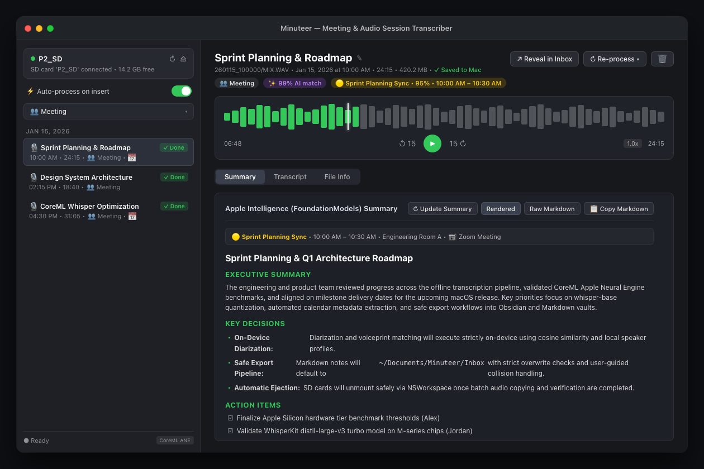

# Minuteer

<p align="center">
  
</p>

<p align="center">
  <strong>Native macOS automated audio ingestion, on-device transcription, and AI-powered meeting minutes.</strong>
</p>

<p align="center">
  <a href="#features">Features</a> •
  <a href="#screenshot">Screenshot</a> •
  <a href="#requirements">Requirements</a> •
  <a href="#quick-start">Quick Start</a> •
  <a href="#configuration">Configuration</a> •
  <a href="#license">License</a>
</p>

---

## Overview

**Minuteer** is a native macOS application designed for hardware field recorders (such as the Zoom F2, `P2_SD`), watch folders, and voice memos. The moment you insert your SD card or connect your audio recorder, Minuteer automatically copies your recordings to your Mac, executes lightning-fast on-device speech-to-text transcription, identifies speakers, correlates recordings with your macOS calendar events, and generates structured Markdown notes with actionable executive summaries directly into your personal note vault.

<a name="screenshot"></a>
## Screenshot



---

<a name="features"></a>
## Features

- ⚡ **Zero-Click SD Card Ingestion**: Automatically detects your field recorder SD card (e.g., `P2_SD`) upon insertion, verifies recording integrity with SHA-256 checksums, imports files to your local library, and offers safe automated card unmounting.
- 🎙️ **On-Device Offline Transcription**: Powered by **WhisperKit** (CoreML & Apple Neural Engine) with fallback to Apple's native Speech Recognition framework. Transcribe audio locally with zero cloud dependencies or recurring fees.
- 👥 **Speaker Diarization & Voiceprints**: Recognizes recurring speakers across sessions using local audio voiceprints and cosine similarity. Features interactive speaker renaming, turn splitting, and turn merging.
- 📅 **macOS Calendar Auto-Matching**: Queries your local macOS calendar to find meetings matching recording start times, capturing meeting titles, attendees, and sanitized agendas into frontmatter.
- 🧠 **Dual Summarization Engines**:
  - **Apple Intelligence (`FoundationModels`)**: Local, privacy-first summary generation on supported Apple Silicon Macs.
  - **OpenAI-Compatible Endpoints**: Connect to local LLMs (Ollama, LM Studio) or cloud providers (OpenAI, Groq, OpenRouter) with full model selection.
- 📝 **Vault-Ready Markdown Archiving**: Generates clean Markdown files with YAML frontmatter, executive summaries, key decisions, and actionable task checkboxes (`- [ ]`) formatted for **Obsidian**, **Bear**, **Logseq**, or **jrnl**.
- 🎧 **Interactive Audio Player**: Listen to recordings directly inside the app with high-resolution waveforms, scrubber pins, variable playback speeds (0.75x–2.0x), and instant jumps to specific transcript turns.
- 🛡️ **Strict Data Safety**: Audio files are never deleted from source media without explicit confirmation; existing notes in your export inbox are never silently overwritten.

---

<a name="requirements"></a>
## Requirements

- **Operating System**: macOS 14.0 (Sonoma) or macOS 15.0+ (Sequoia)
- **Architecture**: Apple Silicon (M1/M2/M3/M4) recommended for hardware-accelerated CoreML transcription and Apple Intelligence features.
- **Xcode / Command Line Tools**: Swift 6.0+ toolchain.

---

<a name="quick-start"></a>
## Quick Start

### Build & Install

Clone the repository and run the automated build scripts:

```bash
git clone https://github.com/johndolljr/Minuteer.git
cd Minuteer

# Run tests and verify code coverage gates (85% region, 80% line, 90% functions)
./scripts/test.sh

# Build release binary and install to ~/Applications/Minuteer.app
./scripts/install.sh
```

### Development Scripts

The `scripts/` directory provides convenient development helpers:

| Script | Purpose |
| :--- | :--- |
| `scripts/build.sh [Debug\|Release]` | Compiles the project using Swift Package Manager. |
| `scripts/run.sh [Debug\|Release] [--no-build]` | Builds and launches Minuteer with console logging. |
| `scripts/test.sh` | Executes the unit test suite and enforces test coverage thresholds. |
| `scripts/install.sh` | Assembles the release bundle into `~/Applications/Minuteer.app` and signs the binary. |

---

<a name="configuration"></a>
## Configuration

All preferences can be configured via **Settings** inside the app:

### 1. Storage & Ingestion
- **Target Volume Name**: Set the SD card volume label to watch (default: `P2_SD`).
- **Export Directory**: Choose the destination inbox for generated Markdown notes (defaults to `~/Documents/Minuteer/Inbox`).
- **Audio Library**: Directory where local audio copies are archived (defaults to `~/Music/Minuteer`).
- **Watch Directory**: Optional folder on your Mac continuously monitored for dropped audio files.

### 2. Session Classifiers & Prompts
Minuteer classifies recordings and tailors AI prompts depending on the context:
- **Meeting**: Extracts executive summaries, key decisions, attendees, and owner-assigned action items.
- **Therapy / Reflection**: Highlights emotional tone, breakthroughs, recurring patterns, and personal intentions with strict confidentiality.
- **Custom**: Define your own system instructions and prompts.

### 3. Model Preferences
- **Speech-to-Text**: Select between `distil-whisper_distil-large-v3_turbo`, `openai_whisper-base`, or Apple Speech Recognition.
- **Summarization Provider**: Toggle between on-device Apple Intelligence or OpenAI-compatible REST API (e.g. `http://localhost:11434/v1` for Ollama).

---

<a name="license"></a>
## License

Minuteer is open source software licensed under the [MIT License](LICENSE).
